# 6주차 과제 — 재질을 읽고, 재질 변화를 코딩하기

## 1. 실습 1 — 단계별 PBR 재질 구현

### 1.1 구현 과정

**① TODO 1 — 색 텍스처**

`uColor`에서 UV 좌표에 해당하는 색상을 읽고, sRGB를 선형 색 공간으로 변환하여 기본 색상에 적용하였다. 회색 큐브에 녹슨 금속의 색상과 무늬가 나타났다.

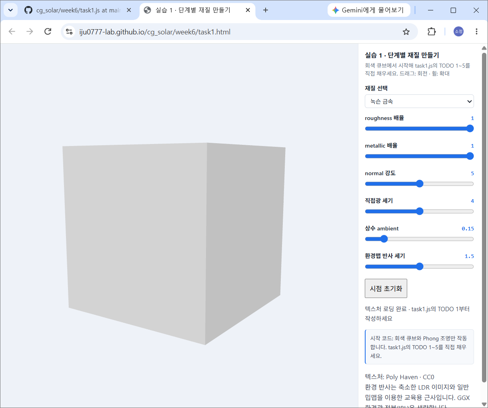

**② TODO 2 — PBR 조명**

기존 Phong 조명을 D(GGX), F(Schlick), G(Smith-Schlick)를 이용한 PBR 계산으로 교체하였다. Roughness를 조절하면 반사 하이라이트의 퍼짐이 달라졌고, Metallic을 높이면 확산광이 줄어들어 큐브가 상대적으로 어두워졌다.

**③ TODO 3 — ARM 맵**

ARM 텍스처의 R 채널은 AO, G 채널은 Roughness, B 채널은 Metallic에 연결하였다. 이를 통해 녹슨 부분과 노출된 금속 부분에 서로 다른 재질 값이 적용되도록 하였다.

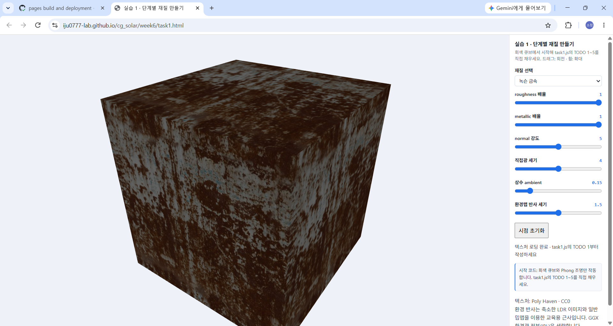

**④ TODO 4 — Normal Map**

접선 공간의 법선을 TBN 행렬을 이용하여 조명 계산에 적용하였다. Normal 강도를 0과 5로 변경했을 때 표면의 명암 차이는 미세했지만, 큐브의 외곽선은 동일하게 유지되었다.

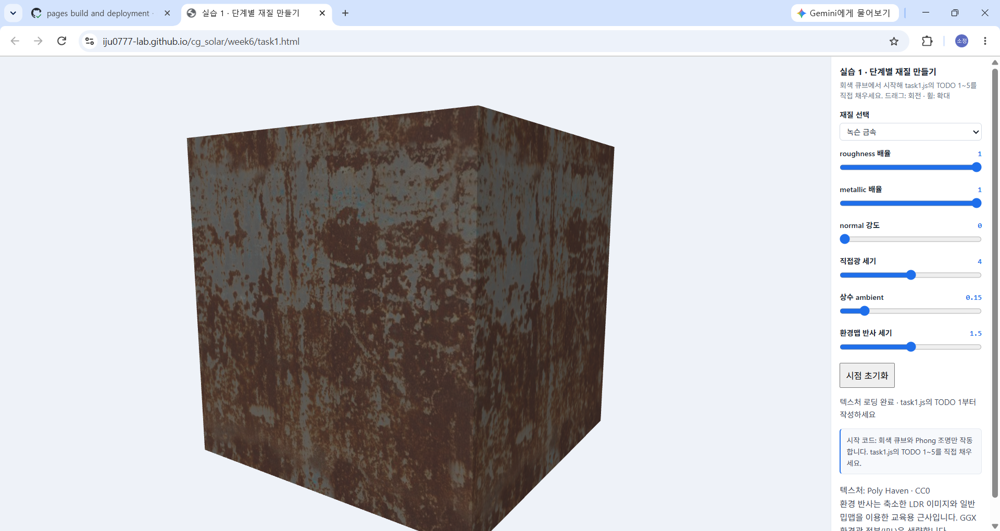

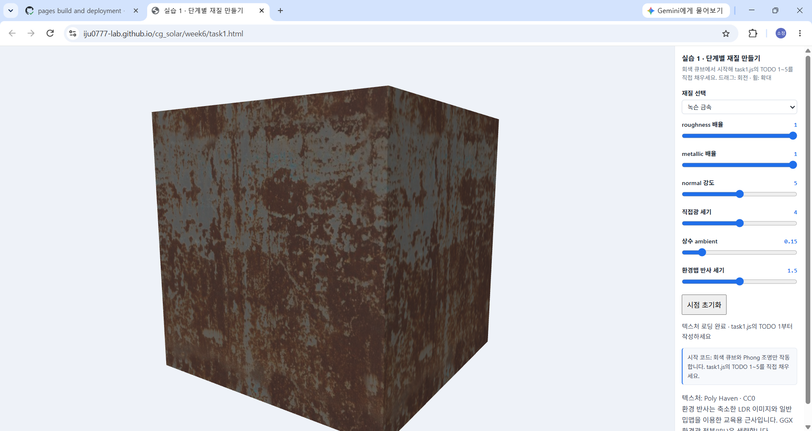

**⑤ TODO 5 — 환경맵 반사**

반사 방향으로 환경 이미지를 조회하여 재질에 환경 반사를 추가하였다. 직접광과 Ambient를 모두 0으로 설정했을 때, 환경맵 반사 세기가 0이면 큐브가 검게 나타났지만 2로 높이면 환경 반사에 의해 표면이 보였다.

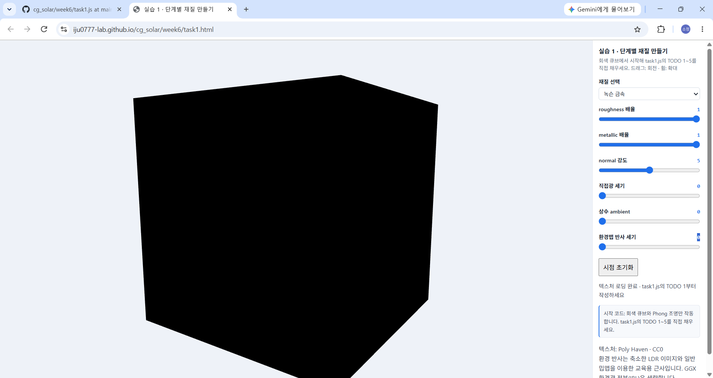

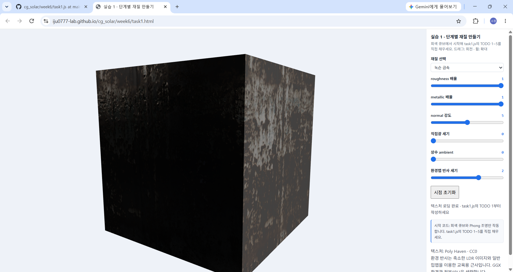

### 1.2 재질별 비교

동일한 큐브에 녹슨 금속, 나무, 돌 재질을 적용하여 비교하였다.

- **녹슨 금속:** 갈색 녹과 회색 금속 영역이 불규칙하게 구분되었다.
- **나무:** 갈색 나뭇결과 판자 사이의 선이 나타났다.
- **돌:** 회백색의 불규칙한 암석 무늬가 나타났다.

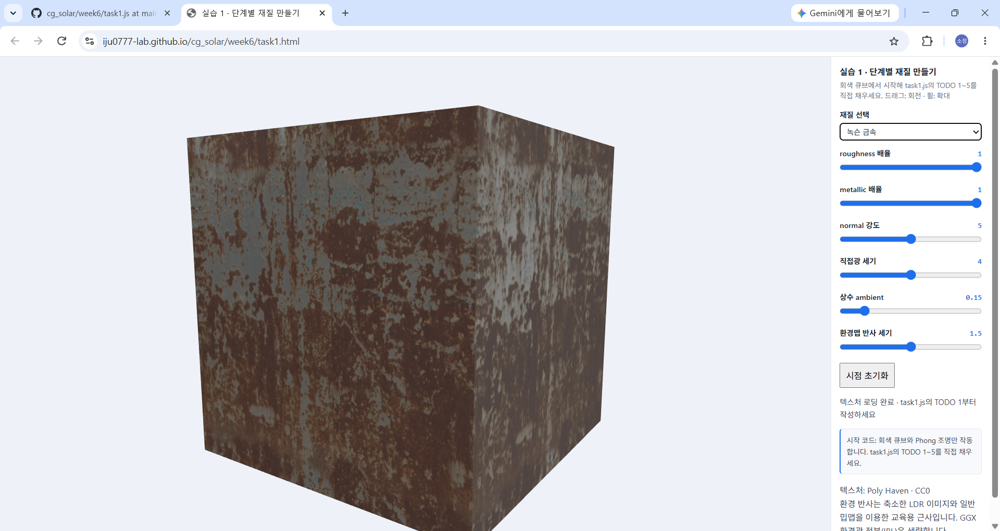

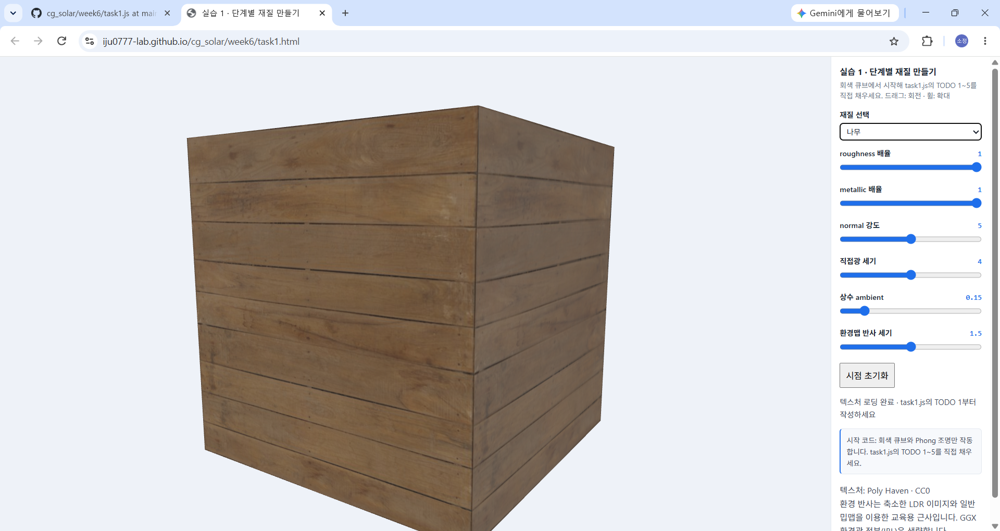

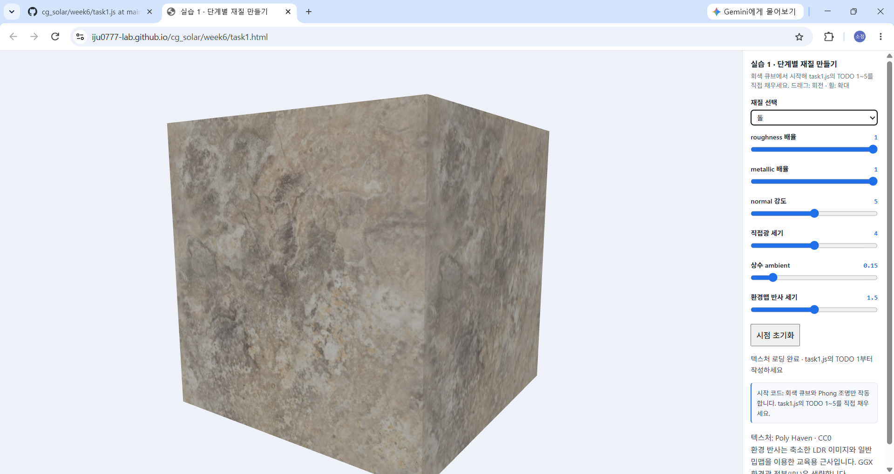

### 1.3 텍스처 필터링 비교

교수님이 제공한 필터링 예제에서 NEAREST와 LINEAR_MIPMAP_LINEAR를 동일한 카메라 시점에서 비교하였다.

NEAREST에서는 멀리 있는 바닥의 격자무늬가 거칠고 불규칙하게 나타났지만, LINEAR_MIPMAP_LINEAR에서는 무늬가 상대적으로 부드럽게 표현되었다. 이를 통해 밉맵과 선형 보간이 텍스처 축소 시 발생하는 Aliasing을 완화한다는 것을 확인하였다.

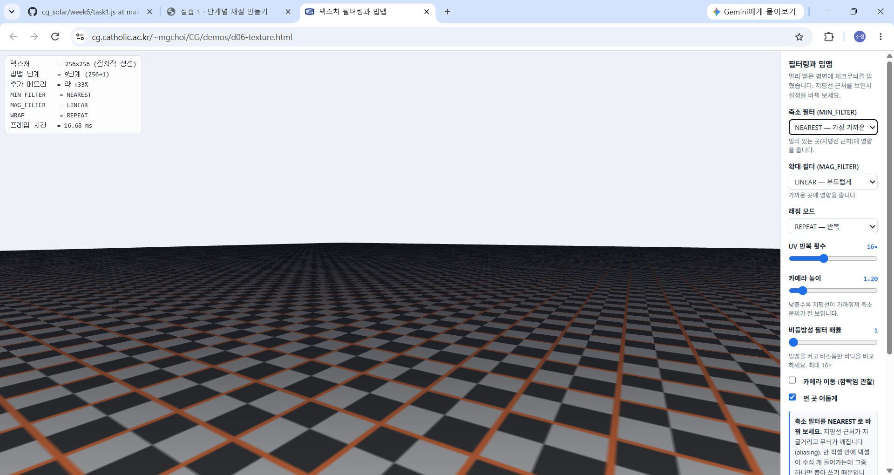

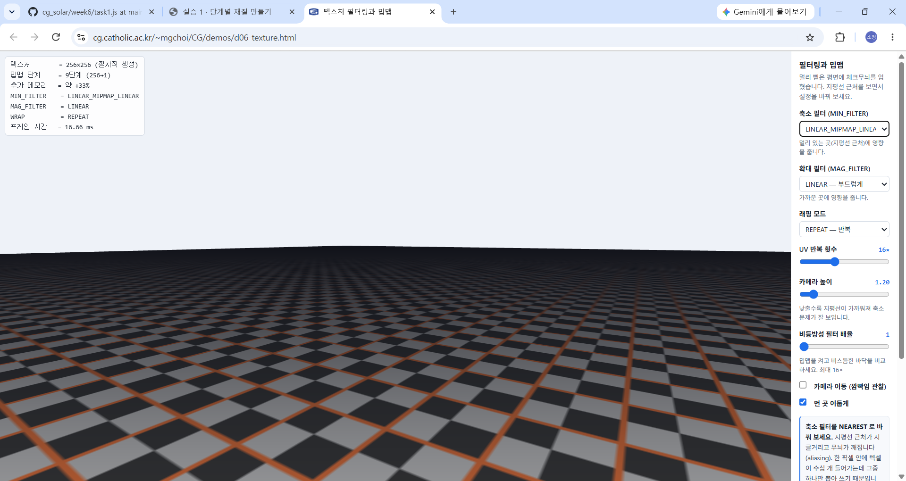

### 1.4 텍스처 출처 및 라이선스

- **나무:** [Poly Haven — Wood Planks](https://polyhaven.com/a/wood_planks)
- **녹슨 금속:** [Poly Haven — Rusty Metal 04](https://polyhaven.com/a/rusty_metal_04)
- **돌:** [Poly Haven — Rock Boulder Dry](https://polyhaven.com/a/rock_boulder_dry)
- **환경 이미지:** [Poly Haven — Studio Small 09](https://polyhaven.com/a/studio_small_09)

라이선스: CC0 1.0

사용한 재질은 색상 맵(Diffuse), OpenGL 방식의 법선맵(nor_gl), ARM 맵으로 구성하였다. ARM 맵은 R(AO), G(Roughness), B(Metallic) 채널을 사용하였다.

상세 출처: `assets/week06/sources.json`

### 1.5 실행 주소

https://iju0777-lab.github.io/cg_solar/week6/task1.html

---

## 2. 실습 2 — Crackworld: 균열의 행성

### 2.1 행성 설정과 의도

태양열과 화산 활동으로 지각이 변하는 가상의 행성 **Crackworld**를 제작하였다. 태양에 가까워지면 표면에 뜨거운 균열이 늘어나고, 화산 활동이 강해지면 검은 화산암 지대와 붉은 용암 흐름이 나타나도록 설계하였다. 5주차의 태양계 장면을 참고하여 자체발광 태양과 자전하는 구형 행성을 배치하였다.

### 2.2 표면 변화 규칙과 코드

실습 1의 PBR(D·F·G), 색 텍스처, ARM 맵, Normal Map, 환경맵 계산을 행성 표면에 적용하였다. 위치·법선은 `uModel`을 통해 월드 좌표계로 변환하였고, 표면 변화 마스크는 로컬 위치 `vLocal`과 3D 노이즈를 이용해 계산하였다.

| 조건 | 계산 코드 | 표면 변화 |
| --- | --- | --- |
| **태양 접근도** (`uSolarLevel`) | `planetX` 및 `solarMask` | 접근도 증가 시 행성이 태양 쪽으로 이동하고, 주황색 발광 균열 영역이 확대된다. 균열 부분의 base color와 roughness·metallic이 변화한다. |
| **화산 활동 강도** (`uVolcanoLevel`) | `volcanoMask` 및 `lavaFlow` | 화산 활동 증가 시 검은 화산암 지대가 넓어지고 일부에 붉은 용암 흐름이 나타난다. 화산암은 더 거칠고 어두운 재질로 바뀐다. |

두 마스크를 계산하는 코드는 `task2.js`의 프래그먼트 셰이더에 있다. 태양 접근도에 따른 행성 이동은 `planetX` 계산 부분에서 처리한다. 두 효과가 겹치는 곳은 **태양 균열 → 화산암 → 용암 흐름** 순서로 재질을 적용하므로 뒤에 적용한 재질이 우선한다.

### 2.3 조건별 비교

행성 자전을 끄고 같은 카메라 시점에서 각 조건을 `0 → 50 → 100`으로 변경한다. 비교 중 다른 조건은 0으로 고정한다.

**① 태양 접근도 비교 — 화산 활동 강도 0**

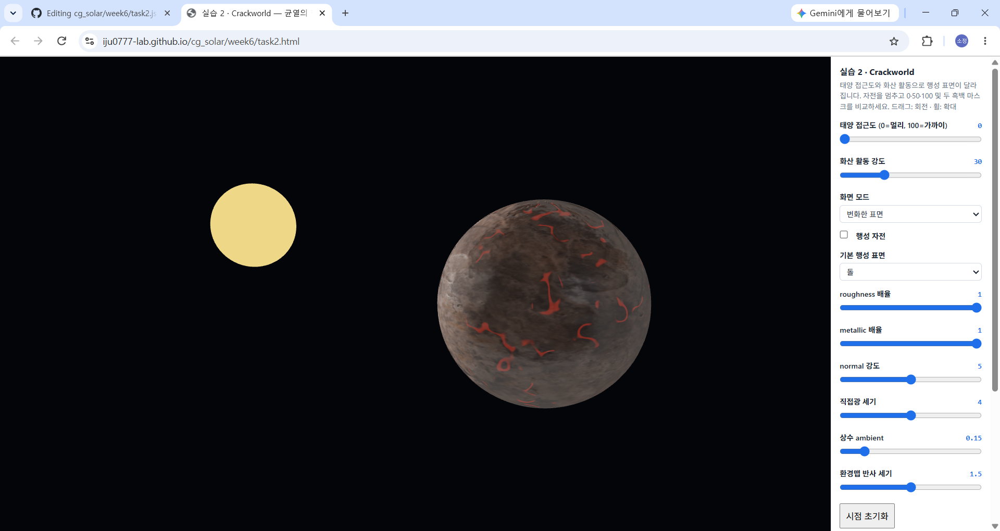

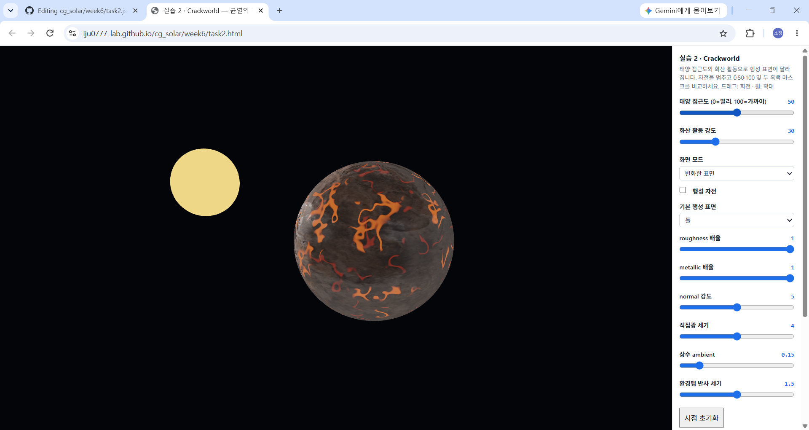

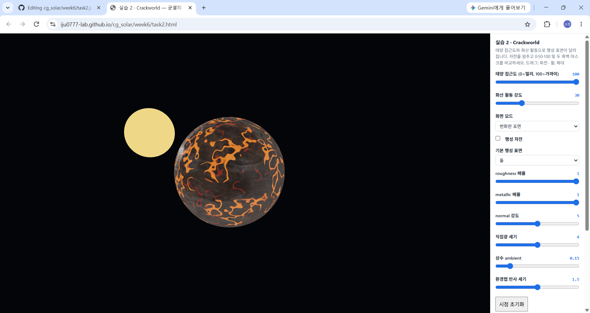

**② 화산 활동 비교 — 태양 접근도 0**

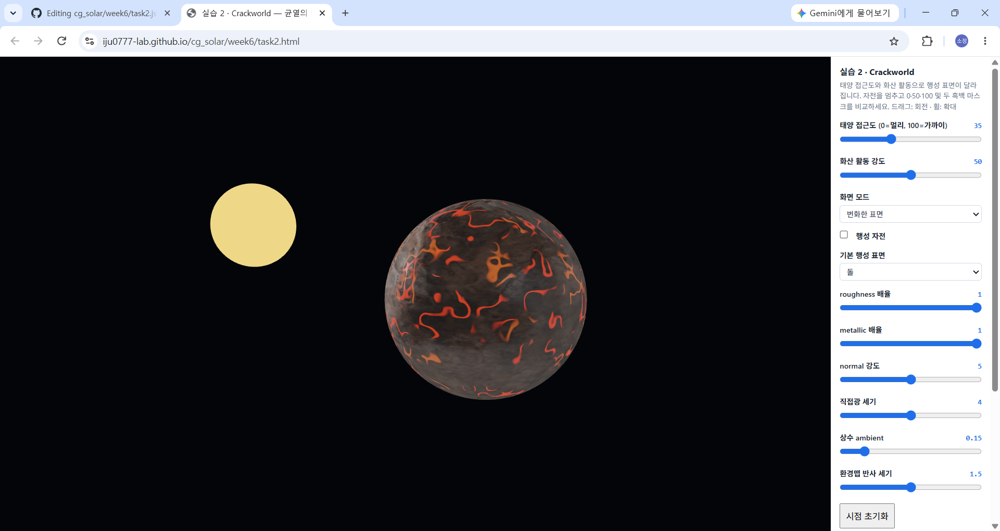

### 2.4 흑백 마스크 확인

'화면 모드'에서 각각의 마스크를 흑백으로 확인할 수 있도록 구현하였다. **마스크 1(`solarMask`)**은 태양열로 변화하는 균열 영역, **마스크 2(`volcanoMask`)**는 화산암 영역의 영향도를 나타낸다. 밝은 부분일수록 해당 변화의 적용 정도가 크다.

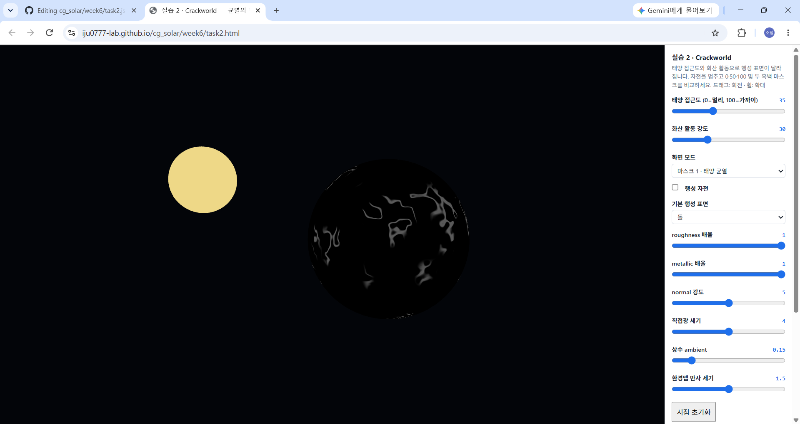

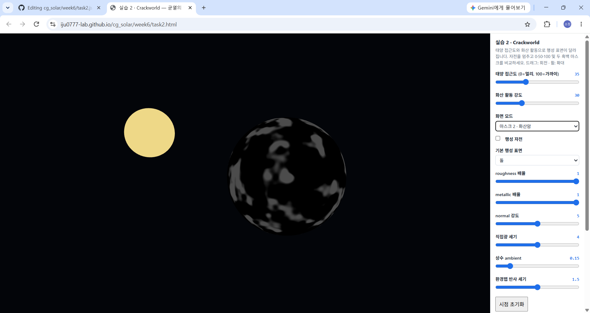

### 2.5 기본 표면과 변화한 표면 비교

같은 조건(태양 접근도 80, 화산 활동 강도 70)에서 '기본 표면'과 '변화한 표면' 모드를 비교한다. 기본 표면은 돌 텍스처를 사용하며, 변화한 표면에는 두 마스크에 따라 색뿐 아니라 roughness와 metallic이 위치별로 변경된다. 균열과 용암 흐름에는 별도의 발광색도 더하였다.

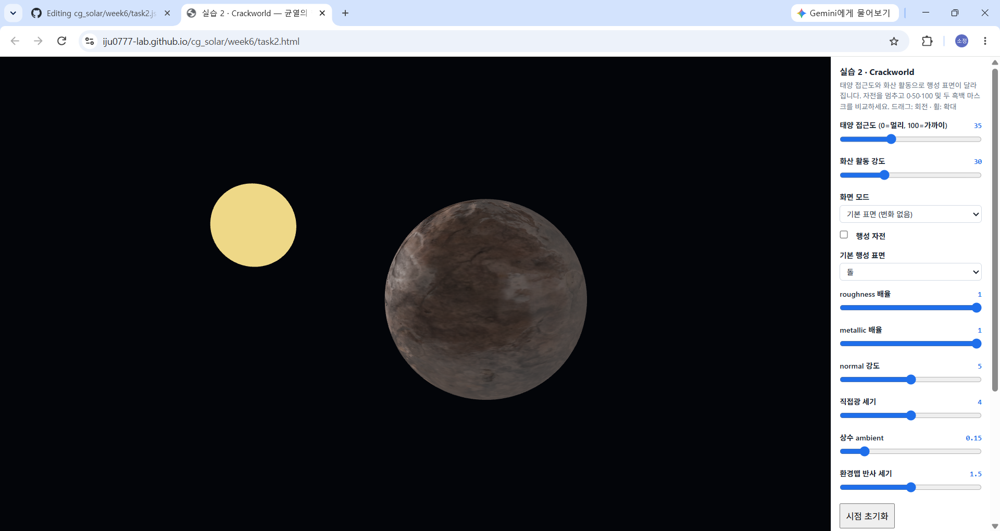

### 2.6 AI 사용 및 수정

AI에 실습 1의 PBR 코드를 활용하여 태양과 자전하는 행성을 구현하고, **태양 접근도·화산 활동 강도에 따라 독립적으로 변하는 두 표면 마스크**와 흑백 진단 화면을 추가해 달라고 요청하였다. 처음 결과에서는 주황색 균열이 규칙적인 격자무늬처럼 보여, 실제 용암 균열에 가깝도록 **3D 노이즈를 이용해 선의 방향과 굵기를 불규칙하게 수정**해 달라고 추가 요청하였다. 화산 활동에도 검은 화산암뿐 아니라 일부 지역의 붉은 용암 흐름을 표현하도록 수정 방향을 제시하였다.

### 2.7 실행 주소 및 이미지 출처

- 실행 화면: https://iju0777-lab.github.io/cg_solar/week6/task2.html
- 코드: [task2.js](task2.js)
- 기본 재질: [Poly Haven — Rock Boulder Dry](https://polyhaven.com/a/rock_boulder_dry), **CC0 1.0**
- 사용 맵: Diffuse(색상), nor_gl(OpenGL 방식 Normal Map), ARM(R: AO, G: Roughness, B: Metallic), 환경맵
- 세부 출처: [assets/week06/sources.json](assets/week06/sources.json)

