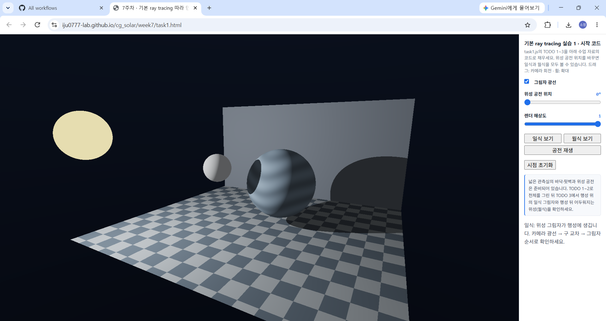
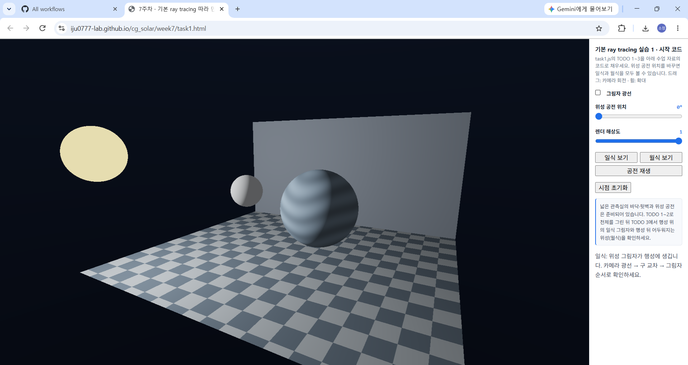
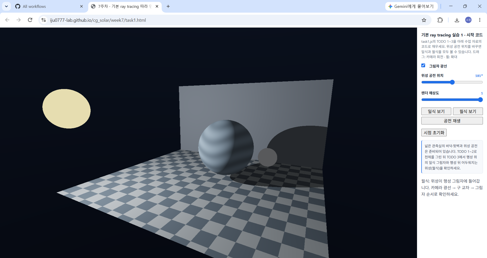
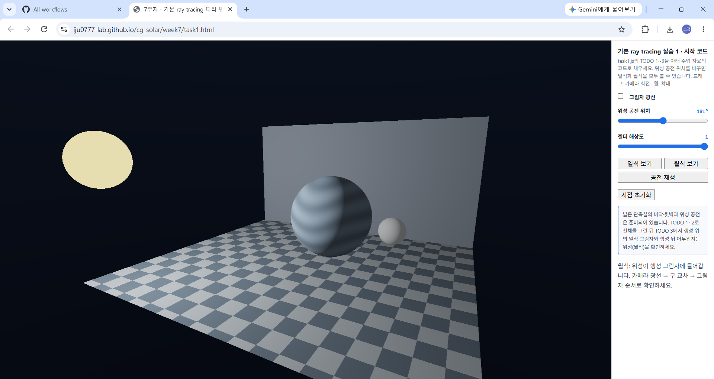

# 7주차 과제 — 전역 조명과 Ray Tracing·Path Tracing

## 1. 실습 1 — 기본 Ray Tracing으로 일식&월식 구현

### 1.1 구현 과정

**① TODO 1 — 카메라 광선 생성**

`cameraRay()`에서 픽셀 좌표와 카메라의 forward,right,up 방향을 이용하여 광선 방향을 계산하였다. 모든 픽셀에 동일한 방향으로 광선을 보내던 초기 상태와 달리, 바닥과 뒷벽이 원근감 있게 나타났다.

**② TODO 2 — 광선과 구의 교차**

`hitSphere()`에서 2차 방정식의 판별식을 이용하여 광선과 구의 교차 여부를 계산하였다. 가장 가까운 양수 교차 거리를 반환하도록 구현하여 별·행성·위성이 화면에 나타났다.

**③ TODO 3 — 직접광과 그림자**

`shade()`에서 표면 법선과 광원 방향을 이용하여 직접광을 계산하였다. 그림자 광선을 통해 광원과 표면 사이에 다른 물체가 있는지 확인하고, 빛이 가려진 영역의 직접광을 차단하였다.

### 1.2 일식·월식 비교

**① 일식 — 위성 공전 위치 0°**

별과 행성 사이에 위성이 위치하면서 행성 표면에 위성의 그림자가 나타났다. 그림자 광선을 해제하면 행성 표면과 바닥·뒷벽의 그림자가 사라지는 것을 확인하였다.

**② 월식 — 위성 공전 위치 약 180°**

행성이 별과 위성 사이에 위치하면서 위성이 행성의 그림자에 들어갔다. 그림자 광선을 켰을 때 위성이 어둡게 나타났으며, 해제하면 다시 밝아지는 것을 확인하였다.

### 1.3 실행 주소

https://iju0777-lab.github.io/cg_solar/week7/task1.html

---

## 2. 실습 2 — Local / Ray / Path Tracing 화질·성능 비교

*실습 2 구현 및 기기별 성능 측정 후 작성 예정*
